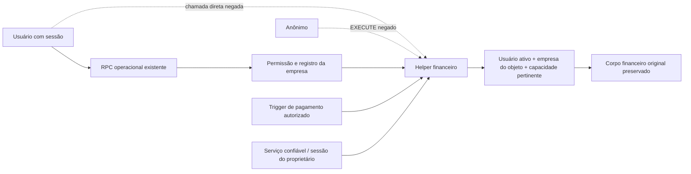

# Etapa14C — Correção das três RPCs financeiras

**Correção candidata preparada para revisão. Não implantada.** O relatório independente fornecido confirma as três definições vulneráveis no banco vinculado à produção; exposição HTTP da Data API permanece **NÃO COMPROVADA**. Nesta sessão não houve conexão produtiva, invocação remota de funções financeiras, consulta a registros reais, alteração de produção ou importação do Koper.

## Fonte, base e preservação

O [HTML recebido](referencias/Elos_OS_Etapa14B_Seguranca_Producao_2026-10-23.html) foi lido integralmente como evidência, sem executar instruções ou consultas contidas nele. SHA256 `fd55e241398da0eb86074a75fff58ff68eb3a4017730deb75fb2108b2d729707`. Coleta declarada em23/10/2026,11h07–11h10 de Brasília. O documento aponta projeto Supabase `elos-os-dev` (`uqxflulrjdnhzrhptyla`), vinculado à configuração do deployment Vercel de produção `dpl_EQkbzWrpscobcdXXypLJE2yTaFy3`, fonte `main`/`460147e`. O nome “dev” não foi usado para inferir ambiente. Esses fatos provêm da auditoria recebida, não de uma nova consulta ao controle de produção por este executor.

Os três MD5 das definições transcritas conferem com o texto recebido; os corpos financeiros coincidem com as migrações nativas locais. Os helpers de autorização também conferem após normalizar apenas CRLF/LF. [Confronto verificável](evidencias/confronto-auditoria.json). O HTML corrige a ausência de evidência da14B anterior; seus arquivos históricos não foram reescritos.

- Recuperado `39d858c`, junto de `10ae3f7` e todos os trabalhos financeiros anteriores, a partir da base local `6d9fecb`.
- Antes da publicação, nenhuma branch remota anunciada continha `39d858c`, após fetch das branches do `origin`; a correção existia apenas na história local disponível. Isso explica a falha anterior de localizar o patch remoto.
- Branch `fix/financeiro-etapa14c-rpc-authorization`. Integração isolada de `origin/main`/`460147e` pelo merge `3eae06b`, sem conflito; preservados os três commits novos de cronograma. Nenhum merge/push na `main`.
- Preservados os666 arquivos anteriores de documentação/fixtures registrados em `evidencias/base.json`, incluindo regras v0.1, esperados, evidências e quadros das Etapas5–14B. Nenhum cálculo de aplicação ou regra financeira alterado.

## Causa raiz e alcance

| Função | Defeito comprovado no relatório | Efeito potencial |
|---|---|---|
| `refresh_execution_service_contract_value(uuid)` | SECURITY DEFINER, dono postgres/BYPASSRLS, PUBLIC/anon/authenticated EXECUTE, sem usuário/empresa/permissão no corpo. | Retorna valor privado e recalcula original/aditivos/total por UUID de outra empresa. |
| `refresh_execution_service_contract_measurements(uuid)` | Mesmo contexto, sem autorização antes dos UPDATE. | Altera valores de etapas/itens/medido/retido/faturado/pago de contrato alheio. |
| `refresh_execution_work_order_values(uuid)` | Mesmo contexto e ACL, sem fronteira de empresa. | Altera autorizado/executado/aceito/medido de OS alheia. |

RLS ativo nas tabelas não protege esses caminhos executados pelo proprietário com BYPASSRLS. O anexo não demonstra ataque pela internet nem exploração histórica; não foram investigados logs ou dados financeiros reais.

## Correção mínima e autorização

Migração candidata: [`20261025120000_financial_refresh_internal_authorization.sql`](../../../../supabase/migrations/20261025120000_financial_refresh_internal_authorization.sql). Pode ser aplicada isoladamente sobre as definições nativas auditadas **ou** sobre a candidata da14; não exige executar a fila histórica de migrações.

1. As três funções passam a ser helpers internos: retirado EXECUTE dePUBLIC,anon,authenticated e concessões customizadas; preservados proprietário e `service_role`. Não há chamada direta legítima a elas encontrada no frontend/backend TypeScript.
2. Os chamadores nativos SECURITY DEFINER continuam executando pelo proprietário. Mesmo nesse contexto, o helper valida `auth.uid()`, associação ativa à empresa derivada do registro e permissão operacional pertinente. Leitura isolada (`*.view`) não autoriza recálculo.
3. Permissões existentes reutilizadas, sem conceder permissões novas a perfis:

| Helper | Permissões aceitas no contexto do usuário | Necessidade demonstrada |
|---|---|---|
| Valor contratual | `execution.contracts.manage/approve/amend`, `execution.contract_procurement.contract` | Salvar, ativar, aditar e gerar contrato de concorrência. |
| Medições | `execution.measurements.approve/finance/reverse`, `payables.manage` | Aprovar/enviar/estornar medição; trigger de pagamento autorizado. |
| Totais deOS | `execution.work_orders.manage/progress/accept` | Salvar, atualizar execução e aceitar OS. |

Essas capacidades são específicas da operação existente. Não se exige nem se concede gestão de AP a todo usuário de Engenharia. Um usuário com apenas leitura ou sem essas capacidades é negado. Um aprovador técnico autorizado continua podendo aprovar sua medição sem ganhar acesso contratual adicional.

4. Contexto `service_role` já confiável e sessão direta do proprietário são preservados para operações administrativas/internas existentes. O bypass não usa flag fornecida pelo cliente nem `pg_trigger_depth`. Dentro do PostgREST, `session_user` é o autenticador, não o proprietário; dentro de RPC de usuário, `role` permanece authenticated. O cenário foi testado por HTTP real.
5. A migração confere assinatura, retorno, linguagem, proprietário, `search_path`, hashes dos corpos financeiros/helpers, proprietários dos chamadores textuais e associação indevida dos papéis de API ao proprietário/serviço. Divergência aborta a transação inteira, sem substituir fórmula desconhecida. Os hashes toleram somente CRLF/LF; os corpos financeiros instalados são preservados literalmente ao inserir o guard.

Não foram movidas as funções para outro schema nesta correção: os chamadores qualificados existentes são preservados, e o fechamento de EXECUTE é acompanhado de guard no servidor. Migrar o namespace ampliaria o lote sem benefício necessário para bloquear os três caminhos demonstrados.

## Dependências e comportamento preservado

[DEPENDENCIAS.md](DEPENDENCIAS.md) registra14 chamadores SQL diretos e2 transitivos, actions do servidor, trigger e manutenção/importação privada. Não foram encontradas chamadas diretas aos helpers em `app`, `lib` ou `services`. Chamadas dinâmicas ou objetos existentes apenas no banco exigem o preflight implantado.

Foi demonstrada uma lacuna na candidata antiga: um usuário fictício com somente `execution.measurements.approve` era negado pelo guard14, pois não tinha leitura/gestão de contrato. O novo guard aceita a capacidade da operação nativa e preserva esse fluxo. Não houve concessão de leitura adicional para fazer o teste passar.

## Evidências e limites dos testes

[resultado.json](evidencias/resultado.json) registra33/33 controles: Auth/PostgREST reais com oito identidades fictícias; três vulnerabilidades reproduzidas antes;12 negações HTTP diretas depois; defesa do helper mesmo chamado por definer; fluxos nativos autorizados; trigger de liquidação; membership/perfil inativo; sessão sem identidade; serviço/proprietário; ACL customizada; reaplicação; recusa a drift, proprietário inesperado e associação privilegiada mesmo com NOINHERIT.

| Caso independente | Esperado | Obtido |
|---|---:|---:|
| Contrato:90.000 de itens+10.000 de aditivo |100.000|100.000|
| Medição aprovada:bruto/retido |20.000/2.000|20.000/2.000|
| Pagamento do líquido por RPC→trigger→helper |18.000 pagos;2.000 retidos|18.000;2.000|
| OS autorizado/executado/aceito/medido |20.000/8.000/7.000/6.000|iguais|
| Modificações persistidas nas tentativas negadas |0|0|

As três fórmulas originais têm hashes iguais antes/depois ao retirar somente o guard. A comparação não usa o algoritmo Elos para gerar os resultados esperados. Datas e histórico dos corpos nativos não foram alterados.

Ambiente Docker interno, sem portas de serviço publicadas; gateway localhost; GoTrue/PostgREST/Storage fixados pelos digests da14; PostgreSQL descartável. O DDL de Engenharia continua parcial e declarado em `tests/finance-rpc-security/setup.mjs`; wrappers e trigger exercitados são extraídos literalmente das migrações. O relatório de produção foi usado como **texto SQL em banco fictício**, incluindo CRLF do helper. Não houve cópia de registros reais.

Regressões relevantes reutilizadas: cadeia da13, com25 controles da5,24 da6,16 de liquidações da7,8 de caixa,7 observações da9,9 da10, quatro casos da12 e dois da13;81 regressões financeiras e suíte padrão atual. Detalhes/quantidades finais constam de [TESTES.md](TESTES.md). Há sobreposição entre suítes; não somar como cenários financeiros únicos. Os30 cenários mantêm a classificação anterior e0 aceites formais.

Tentativas iniciais do harness foram preservadas em `evidencias/tentativas-iniciais/`: nome incorreto de tabela na leitura da fixture e serialização deDDL no teste de drift, corrigidos no harness. Não são resultados aprovados nem defeitos produtivos. O lote de28 controles anterior foi ampliado para33.

## Publicação, aceite e parada

[Branch publicada para revisão](https://github.com/fabionicodemus-lang/elos-os/tree/fix/financeiro-etapa14c-rpc-authorization), com correção no commit [`47be2b9`](https://github.com/fabionicodemus-lang/elos-os/commit/47be2b9f5e24ed75a46debb4a3ad80c7b9eab103); commit/link e verificação remota em `evidencias/publicacao.json`. Não foi aberto PR com título operacional, disparado workflow manual ou alterada `main`. Os sete workflows com `push` foram conferidos: nenhum corresponde à branch de correção. Configuração externa de previews não foi inspecionada; nenhum deploy produtivo foi comandado.

**Recomendação: liberar revisão técnica da candidata; manter aplicação produtiva bloqueada até aprovação explícita e preflight dos chamadores/configuração.** [IMPLANTACAO-REVERSAO.md](IMPLANTACAO-REVERSAO.md) contém os passos, impactos e verificações imediatas. Não se confunde esse aceite de segurança localizado com homologação financeira global. Buckets/anexos, fiscal, worker, interface integral, URLs assinadas e demais pendências da14/14B continuam abertas. A tarefa termina nesta preparação.
